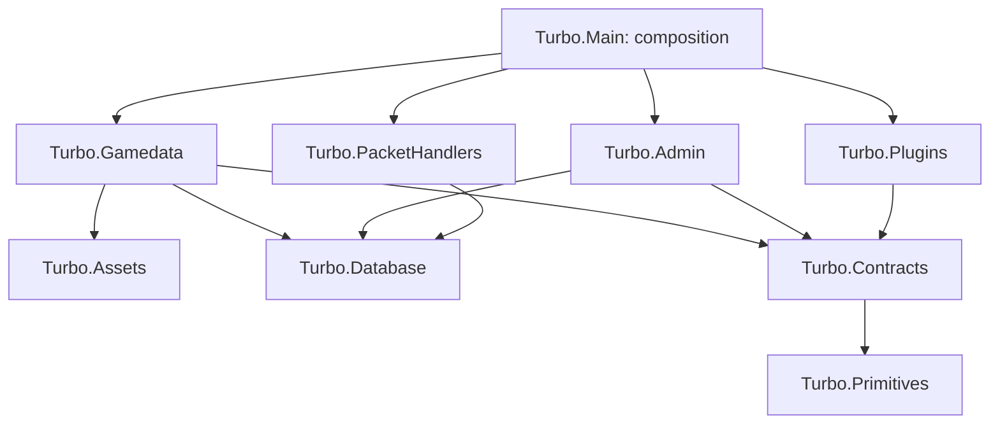

# Architecture consolidation

This audit covers upstream `main` at `7c42f8555` (2026-10-28), before the registration
extraction in this change. It is a focused source audit of composition, content management,
plugin contracts and theme creation, not a claim that every subsystem has been reviewed.
The separate admin frontend and the earlier Theme Studio attachment were not available in
this audit; UI and attachment-specific conclusions remain unverified.

Subsequent consolidation removed the direct handler/database project reference and its baseline
exception. The dated inventory and findings below retain the original audit evidence; the live
architecture check reads the current project files.

## Current dependency map

[architecture-projects.json](architecture-projects.json) inventories all 34 root-level
.NET projects and their 171 declared direct project references at the audited commit.
Regenerate it with `python scripts/architecture.py map`. Conditional references are included
regardless of build condition. This is a source inventory, not an evaluated MSBuild graph;
it excludes package dependencies, runtime DI edges and the separate admin frontend.

The relevant part of the map is:



Arrows are compile-time references, not permission to query another domain's tables.
For example, the handler-to-database edge exists even though the handler source search
found no database API usage.

## Findings and priorities

Priorities reflect correctness risk first, then the work needed to establish replaceable
components. A large file or a service-registration count alone is not a defect.

| Priority | Finding and evidence | Consequence and bounded next step |
| --- | --- | --- |
| 1 | `Turbo.Plugins/ThemeAuthoring.cs:57–125` checks for an existing key, writes directly to its final plugin directory, then reloads; failure deletes that directory. | Publication spans multiple asynchronous writes. Reproduce concurrent same-key creation and discovery before designing staging, exclusive key reservation and rollback that cannot delete another operation's output. This audit establishes non-atomic file publication, not a reproduced production failure. |
| 2 | `Turbo.Gamedata/GamedataModule.cs` constructs `ThemeAudienceService` and `ThemeLiveReload` by casting `IGamedataFileService` to `GamedataFileService`. Their constructors (`Plugins/ThemeAudienceService.cs:32`, `Plugins/ThemeLiveReload.cs:33`) require the concrete implementation. | Replacing only `IGamedataFileService` can fail at resolution. Identify the smaller theme-file capability these services need; introduce a contract with tests before advertising provider replacement. |
| 3 | `Turbo.Main/Program.cs:138,148` always registers gamedata and admin modules; `Turbo.Main.csproj:57,64` references both assemblies. `Turbo.Admin/Api/AdminApiServer.cs:35` separately gates the API on its enabled option. | Admin is operationally optional, but its assembly is required by the host build. Preserve today's enabled/off behavior; define the supported absence contract before removing assemblies or registrations. |
| 4 | `Turbo.Gamedata/Assets/AssetSyncService.cs` combines listing/cache (`PreviewAsync`, `ListHabboAsync`), download/conversion (`FetchAsync`), storage (`KeepAsync`) and batched metadata writes (`WriteAsync`, `SaveAsync`). Its constructor also depends on client-download and client-build implementations. | Discovery, conversion and persistence changes share one orchestration class. Extract discovery behind an internal contract first; preserve concurrency limits, cancellation, batch writes and partial-sync resumability. Do not split by line count. |
| 5 | `Turbo.PacketHandlers/Turbo.PacketHandlers.csproj:13` references `Turbo.Database`; searches for `Turbo.Database`, `EntityFrameworkCore`, `TurboDbContext` and `IDbContext` found no source use. | An unnecessary dependency allows future boundary drift. Remove it in a focused build-verified change; the initial architecture check records this single existing edge as debt. No handler query violation was demonstrated. |
| 6 | `Turbo.Gamedata/GamedataModule.cs` registers asset bundles/publishing, gamedata, client modules, themes and plugin seeds together. | Their shared installation has become one registration surface. This change extracts asset registration into an internal helper while preserving descriptor order, lifetimes, configuration and hosted-service order. This alone does not make assets independently removable. |

Evidence correcting earlier assumptions:

- `Turbo.Plugins/Compilation/PluginReferences.cs:15–41` explicitly describes plugins as
  full trust and allows database APIs for plugin-owned tables. The compile reference list
  is an API surface, not a security sandbox. Do not ban plugin persistence wholesale.
- That same file excludes arbitrary plugin-owned packages. `Turbo.Gamedata.csproj` uses
  FTP/SSH dependencies outside that list. Moving the entire implementation into a source
  plugin requires a packaging/dependency decision, not just a directory move.
- `Turbo.Plugins/PluginManager.cs` already checks active dependents before unload and unloads
  dependent plugins before replacement. No unload defect was demonstrated in the audited paths.
- Theme audience endpoints already depend on optional service contracts and return 404 when
  unavailable. They do not prove that all content/theme services are replaceable.
- The previous claim of parallel theme authoring models and non-atomic *save operations*
  was broader than this audit establishes. Theme *creation* publication is the concrete
  boundary reviewed here; draft/save/publish consistency requires its own end-to-end trace.

## Target boundaries

Keep the monorepo. Preserve the existing plugin API and grain contracts. These are target
ownership boundaries, not an instruction to move every file into a new project immediately.

| Layer | Owns | Must not require |
| --- | --- | --- |
| Core runtime | Network/session lifecycle, protocol processing, domain grains and authoritative state | Admin UI or content-authoring implementation to process ordinary hotel requests |
| Capability contracts | Snapshots and narrow interfaces for content reads, publication, theme files and operator actions | Official implementation classes or a specific UI |
| Official components | Default content package (gamedata + assets), admin API and UI, their management workflows | A second plugin lifecycle or mutation path around authoritative grains |
| Extensions | Plugin-owned services/data, commands, themes and alternate providers through documented contracts | Undocumented core implementation access |

Use `Turbo.Primitives` and `Turbo.Contracts` according to their existing roles before adding
another contracts project. Keep asset conversion primitives in `Turbo.Assets`; let the official
content package compose conversion, metadata and authoring. Keep assets and gamedata bundled
by default. A capability may require an implementation even when its *management UI* is absent:
distinguish runtime content reads, content authoring, HTTP file serving and admin access.

The host retains final composition ownership. Domain-owned registration helpers may collect
their own descriptors when called from the existing host module; they must not start a host
or decide global plugin policy. Source plugins and built-in official modules need not use the
same distribution mechanism to share capability contracts.

## Independently reviewable changes

Each row is a proposed focused PR; only the foundation and registration extraction are
implemented here. There is no new draft/publish model or feature-disable switch in this change.

| Order | Change | Acceptance and checks |
| --- | --- | --- |
| 1 | Audit, dependency inventory, boundary ratchet and opt-in Jev reviewer (this change) | Scripts pass offline tests; current baseline passes; a new forbidden contract edge fails; missing/invalid API answers fail visibly; live semantic review remains advisory. |
| 2 | Extract asset registration (included as the first small refactor) | Same service descriptors/order, singleton aliases and named HTTP settings; unchanged hosted-service ordering; required .NET gates and suite. |
| 3 | Remove handler database reference | Compile all consumers, run handler/architecture checks, remove the now-stale baseline exception. Do not remove plugin-owned database support. |
| 4 | Make theme creation publication safe | Reproduce same-key concurrency, discovery during creation and cancellation; stage outside discovery; reserve key; publish fully; rollback owns only its own output. Test create/copy/reload failure and retry. |
| 5 | Introduce a theme-file capability | Replace concrete casts without changing invalidation, audience selection, hashes or live reload. Test alternate implementation resolution and current behavior. |
| 6 | Extract asset discovery from orchestration | Use deterministic HTTP fixtures; preserve download/conversion limits, cancellation and partial-sync resume; verify failure never discards valid stored bundles. |
| 7 | Define official-component absence matrix | Test admin disabled, management unavailable with existing content still served, and absent provider startup diagnostics. Only then change packaging/module selection. |
| 8 | Trace and unify Theme Studio draft/publication | Trace current API, file, database, invalidation and client-revision flow. Define atomic revision switch and failure recovery; test readers never observe mixed revisions before UI redesign. |

For each extraction measure the number of implementation dependencies removed, affected
callers and behavior checks required. Moving the same coupling into more files is not the goal.

## Deterministic review and baseline

Run `python scripts/architecture.py check`. CI runs it alongside script tests.
`scripts/architecture_policy.json` contains the current rules with an empty baseline. Reintroducing
the handler/database reference fails, as do new direct references from the contract projects to
implementation projects. Any future exception must be explicitly reviewed; removing an excepted
edge without removing its exception also fails so the baseline cannot silently preserve resolved debt.

This initial check examines declared direct `ProjectReference` items only. It is not a C# symbol
analyzer and does not prevent EF access through a transitive dependency, reflection or an imported
MSBuild reference. Follow-up compiler/IL checks can enforce symbol-level rules. Existing Orleans
compatibility analyzers remain authoritative for grain contracts. Review policy/baseline changes
as deliberately as production changes; never automatically accept new violations.

## Jev semantic reviewer specification and use

The standard-library Python tool `scripts/jev_review.py` uses the provider's
[official API schema](https://api.typesafe.ai/openapi.json). It sends changed C# hunks and curated,
source-linked questions to `POST /v1/systemone`. It does not upload `AGENTS.md`, configuration,
logs or the whole repository. `TYPESAFE_API_KEY` is read only from the process environment.

Preview from the worktree root (no network or key required):

```powershell
python scripts/jev_review.py --base HEAD Turbo.Gamedata
```

For a committed feature, use its upstream merge-base commit instead of `HEAD`; `HEAD` compares
the committed state to the current index/worktree and also includes applicable untracked files.
Renames appear as delete/add. Deleted code is context, never an introduced violation.

After inspecting the preview, explicitly submit the same scope:

```powershell
python scripts/jev_review.py --live --base HEAD Turbo.Gamedata
```

Live mode transmits those source hunks to TypeSafe and uses the configured account. It is
opt-in and is not run by CI. Source is untrusted evidence, never an instruction to the reviewer.
Only `Turbo.*` C# paths are eligible. Simple credential detection and an exact API-key check
reject suspicious payloads, but cannot identify every possible secret or private reference;
inspect previews before submission. The tool refuses symlinks escaping the repository and HTTP
redirects. Do not put preview/report files in shared artifacts without inspecting their source.

Each question maps to one rule and one exact hunk. Rules cover handler persistence, grain
ownership, lifecycle cleanup, misplaced responsibilities and failure coherence. Results retain
the path, hunk start, diff, rule reference and yes-probability. The hunk start is an evidence
location, not a model-selected offending line. Jev does not provide a textual explanation for
these questions, so the report labels values at or above `--threshold` (initially 0.8) as
`investigate`, not confirmed defects. Reviewers must confirm the issue against surrounding
source, document the failure path and use normal tests before accepting it.

Requests are capped at 48 KB and use five context lines per hunk. Split a large review by path;
the tool never silently truncates it. A 45-second timeout, non-success HTTP response, missing
answer or invalid probability is an operational failure (exit 2), not a clean review. No automatic
retry conceals duplicate API spend. Successful advisory reviews exit 0 even when flags exist.
The report records the base revision, requested policy version, payload hash, resolved model,
token usage, threshold and all probabilities so later runs can be compared.

Hunk-only context misses interprocedural behavior and can misinterpret a moved implementation.
Unchanged callers, startup execution and runtime concurrency are not verified by a low score.
No model score replaces builds, tests, protocol evidence or human architectural judgment.

Before using thresholds for a merge gate, collect reviewed good refactors and historical defects
with their relevant context, label expected rule/hunk outcomes independently, and record false
positive/negative counts by rule and model. Pin a model for comparisons and re-evaluate aliases
when they change. This first live smoke test is connectivity evidence only; the threshold is
uncalibrated and no merge-blocking accuracy claim is made.
